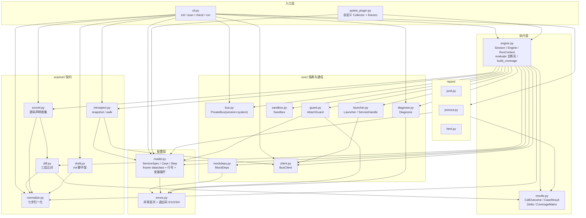
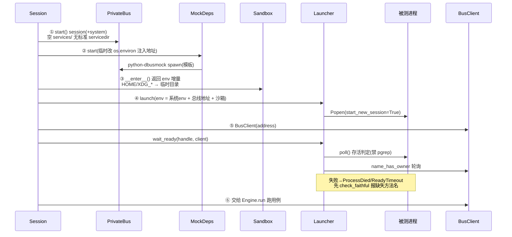
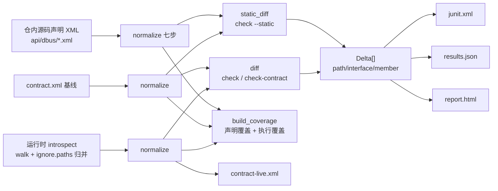
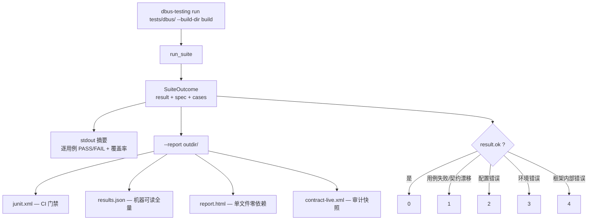

# 架构图

一页看清框架的模块划分、运行时序与契约数据流。模块依赖按**实际 import 关系**绘制。

## 1. 模块分层与依赖



## 2. 运行时启动序列(顺序不可颠倒)



每一步顺序都有实测依据(见各模块 docstring 与 [design.md](design.md) 附录):mock 必须先于被测进程,否则强依赖服务直接 `std::terminate`。

## 3. 契约三方比对(归一化是唯一事实来源)



三方同为**规范化后的标准 D-Bus introspection XML**,故可逐字符直比。归一化七步见
[development.md](development.md),`ignore.paths` 命中路径归并为 `collapsed="true"` 节点。

## 4. 一次 `run` 的产物与退出码



## 5. 关键边界

图里看不到、但决定行为边界的六处:

| 边界 | 位置 | 含义 |
|---|---|---|
| 进程边界 | `Popen` + 私有总线 | 框架与二进制只经 IPC 对话,不链接、不注入、不感知被测语言 |
| 环境边界 | `core/sandbox.py` | 仅隔离 `HOME`/`XDG_*`;`XDG_DATA_DIRS` 保持继承。**不**隔离 `/etc`、`/tmp`、网络 |
| 总线边界 | `core/bus.py` | 无标准 servicedir → 真实服务激活不进来;名字表每条 daemon 独立,同名不冲突 |
| 只读边界 | `core/guard.py` | `mode: attach` 默认只放行 `get-prop` / `check-contract` / `wait-signal` |
| 写入边界 | `tests/test_noninvasive.py` | 写操作限白名单模块;被测仓只读(`chmod 0o500` 后仍跑通) |
| 契约边界 | `scanner/normalize.py` | 只覆盖 introspection 面:不含 annotation、时序/并发语义、总线策略 |

## 6. 文件地图

```
dbus_testing/
├── cli.py            四命令入口、报告落盘、退出码映射
├── pytest_plugin.py  tests.yaml → 原生 pytest 用例 + 逃生舱 fixtures
├── model.py          配置模型与校验(未知字段报错)
├── engine.py         会话生命周期、用例执行、断言求值、覆盖矩阵
├── results.py        执行结果数据结构
├── errors.py         异常层次与错误码
├── core/             总线、拉起、沙箱、依赖 mock、客户端、护栏、诊断
├── scanner/          introspect、归一化、比对、源码声明、init 草稿
├── report/           junit / json / html 三种产出
└── mocktemplates/    框架自带依赖替身(systemd_dde、dconfig、dde_inputdevices…)
```
